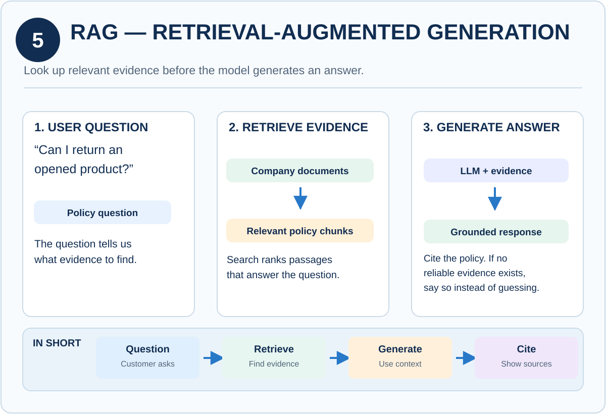

# 🧠 Knowledge Cards

A visual reference library of **32 concept diagrams** covering the core ideas behind modern LLM applications: from tokens and embeddings, through RAG, tool calling and agents, to evaluation, safety and production reliability.

Each card follows the same layout: **what it is → how it works (step by step) → a concrete example**, so you can scan a concept in under a minute.

<p align="center">
  
</p>

---

## 📚 Contents

- [Who this is for](#-who-this-is-for)
- [Suggested learning path](#-suggested-learning-path)
- [The cards](#-the-cards)
- [How to use](#-how-to-use)
- [Adding a card](#-adding-a-card)

---

## 🎯 Who this is for

- Developers starting out with LLM-powered applications
- Students and self-learners who prefer visual explanations
- Teams who want a shared vocabulary for AI system design discussions
- Anyone preparing for AI engineering interviews

---

## 🗺️ Suggested learning path

```
Foundations → Retrieval (RAG) → Application Layer → Orchestration
      → Prompting & Output → Safety → Evaluation → Production Reliability
```

Read the cards in numeric order for a guided path, or jump straight to a section below.

---

## 🃏 The cards

### 1. Foundations

| # | Card | Summary |
|---|------|---------|
| 01 | [LLM](01_llm.svg) | The language engine behind AI assistants: a neural network that predicts tokens |
| 02 | [Tokens](02_tokens.svg) | The small units of text that models read and generate |
| 03 | [Context Window](03_context_window.svg) | The finite token budget a model can use in one request |
| 04 | [Inference](04_inference.svg) | Running a trained model to generate a response (not training) |

### 2. Retrieval & Knowledge

| # | Card | Summary |
|---|------|---------|
| 05 | [RAG](05_rag.svg) ([PNG](05_rag.png)) | Look up relevant evidence before the model generates an answer |
| 06 | [Embeddings](06_embeddings.svg) | Convert content into numeric vectors that capture similarity |
| 07 | [Chunking](07_chunking.svg) | Split long documents into searchable, useful pieces |
| 08 | [Vector Database](08_vector_database.svg) | Index and search embeddings to retrieve similar content |

### 3. Application Layer

| # | Card | Summary |
|---|------|---------|
| 09 | [FastAPI](09_fastapi.svg) | A Python API layer connecting users, models, tools and data |
| 10 | [Tool Calling](10_tool_calling.svg) | The model requests a tool; trusted application code executes it |
| 11 | [MCP](11_mcp.svg) | Model Context Protocol: a standard interface for discovering tools and resources |

### 4. Orchestration

| # | Card | Summary |
|---|------|---------|
| 12 | [LangGraph](12_langgraph.svg) | Represent multi-step AI processes as connected nodes and transitions |
| 13 | [AI Agents](13_ai_agents.svg) | Model-guided systems that choose permitted actions to pursue a goal |
| 14 | [Workflows](14_workflows.svg) | Predefined sequences of steps and branches for reliable tasks |
| 15 | [Conversation Memory](15_conversation_memory.svg) | Stored interaction context that helps the assistant follow a discussion |
| 16 | [Workflow State](16_workflow_state.svg) | Structured values describing where a multi-step task stands |

### 5. Prompting & Output Control

| # | Card | Summary |
|---|------|---------|
| 17 | [Zero-Shot Prompting](17_zero_shot.svg) | Ask a model to do a task without showing examples |
| 18 | [Few-Shot Prompting](18_few_shot.svg) | Show a few examples so the model learns the pattern in context |
| 19 | [Structured Outputs](19_structured_output.svg) | Constrain or validate responses into machine-readable JSON fields |
| 20 | [Pydantic Validation](20_pydantic_validation.svg) | Check untrusted inputs against typed Python models before use |

### 6. Safety & Control

| # | Card | Summary |
|---|------|---------|
| 21 | [Guardrails](21_guardrails.svg) | Controls that constrain inputs, outputs and tool behavior |
| 22 | [Human-in-the-Loop](22_human_in_the_loop.svg) | A human reviews or approves selected AI decisions or actions |
| 29 | [Prompt Injection](29_prompt_injection.svg) | Untrusted content tries to redirect an AI system away from its instructions |

### 7. Evaluation

| # | Card | Summary |
|---|------|---------|
| 23 | [Evaluation Datasets](23_evaluation_datasets.svg) | Representative test cases used to measure system quality |
| 24 | [Evaluation Metrics](24_ai_evaluation_metrics.svg) | Measurements of answer quality, tool use and task success |

### 8. Production & Reliability

| # | Card | Summary |
|---|------|---------|
| 25 | [Model Routing](25_model_routing.svg) | Choose an LLM based on task, constraints and system conditions |
| 26 | [LLM Caching](26_llm_caching.svg) | Reuse valid results to cut repeated inference and retrieval work |
| 27 | [Fallback Strategies](27_fallback_strategies.svg) | Use an alternative path when the preferred AI component fails |
| 28 | [Graceful Degradation](28_graceful_degradation.svg) | Keep useful parts of the app working when AI features fail |
| 30 | [Observability](30_observability.svg) | Trace requests to understand quality, cost, latency and failures |
| 31 | [Rate Limits & Circuit Breakers](31_rate_limits_breakers.svg) | Protect services from overload and cascading failures |
| 32 | [Safe AI Deployment](32_safe_ai_deployment.svg) | Release model and prompt changes with testing and rollback options |

---

## 📁 Folder structure

```
Knowledge/
├── README.md
├── 01_llm.svg
├── 02_tokens.svg
├── ...
├── 05_rag.svg
├── 05_rag.png
├── ...
└── 32_safe_ai_deployment.svg
```

Files are named `NN_topic.svg`, where `NN` is the card's position in the learning path.

---

## 🚀 How to use

**Browse online**
Click any card link above. GitHub renders the SVG directly in the browser.

**Embed a card in your own docs**
```markdown

```

SVGs are vector graphics, so they stay sharp at any size, making them well suited to slides, wikis and blog posts.

---

## 🤝 Adding a card

1. Add a new `NN_topic.svg` to this folder
2. Keep the same structure as the existing cards: a one-line definition, a short step-by-step flow, and a practical example
3. Add a row for it in the right table above

[← Back to the main README](../README.md)