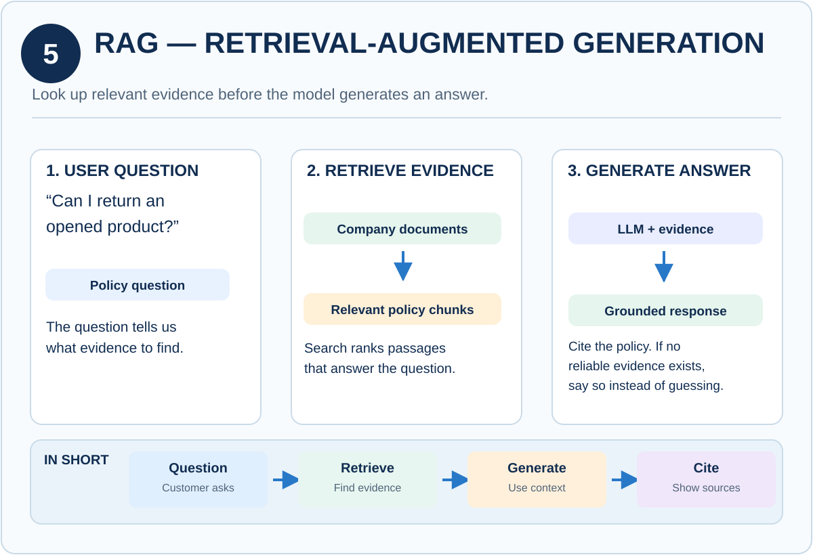

# 🤖 Artificial Intelligence (AI)

A growing collection of notes, visual references and learning material on **AI and LLM-powered applications**, built to make core concepts quick to scan and easy to remember.

---

## 📂 What's inside

| Folder | Description |
|--------|-------------|
| [**Knowledge**](Knowledge/) | 32 visual concept cards covering LLMs, RAG, agents, tool calling, evaluation, safety and production reliability |

> More folders will be added over time. This table is the index.

---

## 🧠 Featured: Knowledge cards

<p align="center">
  
</p>

Each card explains one concept in the same format: **what it is → how it works → a concrete example.**

**Topics covered**

- Foundations: LLMs, tokens, context window, inference
- Retrieval: RAG, embeddings, chunking, vector databases
- Application layer: FastAPI, tool calling, MCP
- Orchestration: LangGraph, agents, workflows, memory, state
- Prompting and output control: zero-shot, few-shot, structured outputs, Pydantic
- Safety: guardrails, human-in-the-loop, prompt injection
- Evaluation: datasets and metrics
- Production: routing, caching, fallbacks, observability, rate limits, safe deployment

👉 **[Browse all 32 cards](Knowledge/README.md)**

---

## 🚀 Getting started

```bash
git clone https://github.com/GauravBhandari19/Artifical-Intelligence-AI.git
cd Artifical-Intelligence-AI
```

Then open any folder and start with its own README.

---

## 🤝 Contributing

Suggestions and improvements are welcome:

1. Fork the repository
2. Create a branch (`git checkout -b my-change`)
3. Make your changes
4. Open a pull request describing what you changed

---

## 👤 Author

**Gaurav Bhandari** — [@GauravBhandari19](https://github.com/GauravBhandari19)

If you find this useful, consider giving the repo a ⭐